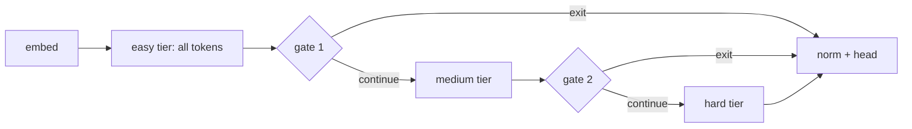

# Adaptive depth with heterogeneous expert tiers

Goal: spend compute where the next token is hard. Easy positions (closing braces,
repeated identifiers, boilerplate) leave after a few layers. Harder positions get
more transformer blocks, and those blocks have larger experts.

## Layout

The MoE stack is split into tiers. Example (`configs/yumon-code-moe-mini-depth.json`):

| tier   | layers | experts               | top-k | capacity |
|--------|--------|-----------------------|-------|----------|
| easy   | 8      | 16 x 512              | 2     | 100%     |
| medium | 8      | 12 x 1024 + 4 x 2048  | 2     | 50%      |
| hard   | 8      | 8 x 3072              | 2     | 25%      |

Within a tier, one router picks among all of the tier's experts, so mixed sizes
compete directly. The Switch balance loss still evens out routed counts per expert.

## Exit gates

Before each tier after the first: `s = sigmoid(Linear(RMSNorm(x)))` per position.
A position continues when `s >= 0.5` and it reached the previous tier, so exits
are permanent. The decision uses only that position's hidden state, which is
already causal. Training and inference make the same decision, and later tokens
cannot change an earlier position's depth (`moe_depth_is_causal_and_trains_gates`).

Inside a gated tier:

- Exited positions are frozen: after each block `x = x + keep * (block(x) - x)`.
  Their frozen state still produces keys and values, so continuing positions can
  attend to them (state copying, as in CALM).
- Only continuing rows enter the MoE (the existing sparse `active` index, now
  shrinking per tier). If no row continues, the tier's blocks are skipped.
- At the tier's end `x = x_in + m * (x_tier - x_in)`, with the straight-through
  mask `m = hard + s - stop_grad(s)`. Forward uses the hard 0/1 decision; the
  gradient reaches `s` as if the tier's update had been scaled by it.

Budget loss, per gated tier: `(mean(m) - capacity)^2`, summed and weighted by
`budget_loss_weight`. Its forward value is the real reached share.

Known limitation: a position that exits gets no language-loss signal about whether
continuing would have helped (its tier delta is zero). Only the budget term pushes
those scores up when a tier is under capacity. Mixture-of-Depths has the same
limitation with threshold routing.

## Compute

Attention still runs for every position in every layer, because exited positions
are needed as keys and values. Q/O for exited queries is wasted work in this
implementation. The savings are in the experts: deeper MoE layers only see
continuing rows. Each gate costs one host readback, the same kind of sync the router
already does per layer. No wall-clock comparison has been measured yet.

## Logs and checkpoints

- Startup prints FFN parameters per tier (total, and expected active per token that
  reaches it).
- Every log interval prints `depth reach: easy 100.0% medium 48.3% hard 32.3%` and
  appends `{"step", "epoch", "steps", "reach": {...}}` to `adaptive_depth.jsonl`.
- `metadata.json` stores the `adaptive_depth` section. Resume requires it to match.
- Checkpoints from before this change have no `exit_gates` field. `load` falls back
  to the old record layout when metadata has no `adaptive_depth`.

## Suggested experiments

1. Compare against `yumon-code-moe-mini.json` / `-32.json` on validation CE at
   equal steps and at equal tokens/s.
2. Check the reach log against capacity. If the gates collapse (every position
   exits or every position continues), raise `budget_loss_weight`. If reach sits at
   capacity but validation CE gets worse, the tiers may be too thin.
3. Try uniform expert widths across tiers, so depth is the only variable, then add
   the larger experts back.
