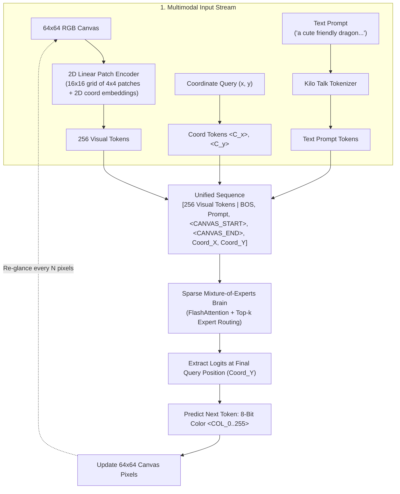
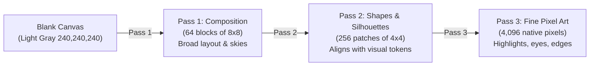

# Multimodal Pixel-Aware Vision & Art Generation Architecture

This document describes how Yumon Pet generates 64×64 pixel art end-to-end from text prompts. It explains the multiscale coarse-to-fine progression, data representation, sequence packing, coordinate querying, and loss calculation.

---

## 1. High-Level Concept

Yumon is a tabletop electronic pet with an autoregressive Mixture-of-Experts (MoE) brain. Rather than relying on a diffusion U-Net or a traditional GAN, Yumon creates art **interactively**:
1. Yumon observes the current canvas through a 2D patch encoder (256 visual tokens).
2. It receives the user's text prompt and a coordinate query $(x, y)$.
3. Its transformer attention heads look at the text prompt, attend across the visual canvas, and predict the exact 8-bit truecolor palette value for that coordinate.
4. The canvas updates, Yumon re-glances at its work, and paints the next region.



---

## 2. Canvas & Token Representation

### 8-Bit Truecolor Palette (256 Colors)
To balance rich artistic expressiveness with a compact vocabulary, Yumon uses a bijective 8-bit truecolor palette (3 bits Red, 3 bits Green, 2 bits Blue):
- **Red ($3$ bits)**: $8$ levels ($0..7 \implies 0, 36, 73, 109, 146, 182, 219, 255$)
- **Green ($3$ bits)**: $8$ levels ($0..7 \implies 0, 36, 73, 109, 146, 182, 219, 255$)
- **Blue ($2$ bits)**: $4$ levels ($0..3 \implies 0, 85, 170, 255$)

$$\text{Palette Index} = (R_3 \ll 5) \mid (G_3 \ll 2) \mid B_2$$

This preserves skin tones, skies, atmospheric lighting, and subtle shadows with zero loss of distinct colors across 256 discrete tokens.

### Dedicated Vocabulary Space (`vocab_size = 4512`)
The vocabulary extends the 4,096-token Diffusion Talk art vocabulary (`training-cache/diffusion_talk_vocab.json`), trained directly on 10,000 DiffusionDB prompts with 400 mined recurring art phrases (e.g. `concept art`, `trending on artstation`, `octane render`, `digital painting`, `sharp focus`):

| ID Range | Token Name | Purpose |
| :--- | :--- | :--- |
| `0..4095` | Diffusion Talk Text Tokens | BPE text vocabulary specifically induced from DiffusionDb art prompts |
| `4096` | `<CANVAS_START>` | Delimiter indicating the canvas state is being queried |
| `4097` | `<CANVAS_END>` | Closes the canvas context tag |
| `4098` | `<PAINT>` | Reserved paint action tag |
| `4099` | `<DONE>` | Reserved completion tag |
| `4100` | `<PASS_1>` | Pass 1: Composition mode ($8 \times 8$ blocks) |
| `4101` | `<PASS_2>` | Pass 2: Shapes & Silhouettes mode ($16 \times 16$ patches) |
| `4102` | `<PASS_3>` | Pass 3: Fine Pixel Art mode ($64 \times 64$ native pixels) |
| `4110..4173` | `<ROW_0>` .. `<ROW_63>` | 64 discrete row coordinates ($Y \in 0..63$) |
| `4174..4237` | `<COL_0>` .. `<COL_63>` | 64 discrete column coordinates ($X \in 0..63$) |
| `4238..4493` | `<COL_0>` .. `<COL_255>` | 256 discrete 8-bit palette colors |
| `4494..4501` | `<RAD_1>` .. `<RAD_8>` | Brush radii |

---

## 3. The 2D Coordinate-Aware Vision Tokenizer & Conv2D Stem

Traditional convolutional neural networks downsample images using pooling (`MaxPool2d`, `AdaptiveAvgPool2d`), creating *translation invariance*. That destroys the exact 2D position of edges and pixels. Pure ViT patch projection, on the other hand, breaks edge continuity across patch boundaries.

Yumon uses a **Conv2D-Enhanced 2D Coordinate-Aware Patch Encoder** ([`src/vision/patch_encoder.rs`](file:///D:/projects/common/yumon-pet/src/vision/patch_encoder.rs)):
1. **Multi-Scale Conv2D Stem**: The $64 \times 64 \times 3$ canvas passes through overlapping $3 \times 3$ convolutions with `PaddingConfig2d::Same` and GELU activation ($3 \to 16 \to 16$ channels). This computes 2D spatial gradients and captures edge continuity across the 8-pixel neighborhood before downsampling.
2. **Patch Grid Projection**: The feature map is projected into non-overlapping $4 \times 4$ patches ($16 \times 16$ grid, 256 visual tokens) directly into `embed_dim` (e.g., 64).
3. **2D Spatial Patch Mixer**: A $3 \times 3$ convolution operates across the $16 \times 16$ macro-patch grid with a residual connection:
   $$\mathbf{P}_{\text{mixed}} = \mathbf{P} + \text{GELU}(\text{Conv2D}_{3\times3}(\mathbf{P}))$$
   This directly links each patch to its vertical and horizontal neighbors $(r \pm 1, c \pm 1)$, bridging the 1D row-wrap discontinuity and eliminating MoE routing jitter along edges.
4. **2D Coordinate Embeddings**: Learned embedding tables (`row_embed` for $y \in [0..15]$ and `col_embed` for $x \in [0..15]$) and RMSNorm anchor the visual tokens:
   $$\mathbf{z}_{r, c} = \text{RMSNorm}\left(\mathbf{W}_{\text{patch}} \mathbf{p}_{r, c} + \mathbf{E}_{\text{row}}(r) + \mathbf{E}_{\text{col}}(c)\right)$$
5. The resulting 256 visual vectors are prepended to the text sequence.

---

## 4. Why Coarse-to-Fine Multiscale Progression?

### The "Fax Machine" Failure
If an autoregressive model is trained to paint scanlines from top to bottom (pixel $(0,0)$, $(0,1)$, $(0,2)$...):
- When predicting $(0,0)$, the canvas is blank. The model has no idea what the bottom or middle of the scene will look like.
- It is forced to invent the scene from scratch with no global grounding.
- Any tiny mistake on line 2 cascades and corrupts the entire remaining image.

### The 3-Pass Solution
Instead of raster scanlines, Yumon paints in **three multiscale passes**:



| Pass | Visual Canvas Input | Query Coordinates $(x, y)$ | Target Color | Granularity | Queries |
| :--- | :--- | :--- | :--- | :--- | :--- |
| **Pass 1: Composition** | Blank canvas | Block centers: $(bx \cdot 8 + 4, by \cdot 8 + 4)$ | Average $8 \times 8$ block color | $8 \times 8$ blocks | 64 |
| **Pass 2: Shapes** | Pass 1 canvas | Patch centers: $(px \cdot 4 + 2, py \cdot 4 + 2)$ | Average $4 \times 4$ patch color | $4 \times 4$ patches | 256 |
| **Pass 3: Details** | Pass 2 canvas | Native pixels: $(x, y) \in [0..63] \times [0..63]$ | Native $64 \times 64$ ground-truth pixel | $1 \times 1$ pixel | 4,096 |

- In **Pass 1**, Yumon establishes global color balance (e.g. blue sky on top, green grass below, brown mass in center).
- In **Pass 2**, Yumon sees the $8 \times 8$ blocks and carves out silhouettes, character faces, and objects.
- In **Pass 3**, Yumon sees the sharpened shapes and renders fine pixel lighting, borders, and textures.

---

## 5. Training Dataset Generation

The dataset generator ([`src/bin/cache_diffusion_kilo.rs`](file:///D:/projects/common/yumon-pet/src/bin/cache_diffusion_kilo.rs)) ingests 1,000 DiffusionDB images and synthesizes **12 multiscale samples per image** (12,000 samples total, ~151 MB binary cache):

1. **Composition Samples (Pass 1 - 2 samples/image, 16.7%)**:
   - Canvas: Blank.
   - Coordinate: 2 block centers (left and right halves).
   - Action: `[PASS_1, ROW_y, COL_x, COLOR_c]`.

2. **Shape Samples (Pass 2 - 2 samples/image, 16.7%)**:
   - Canvas: Pre-rendered $8 \times 8$ composition canvas.
   - Coordinate: 2 patch centers (top and bottom halves).
   - Action: `[PASS_2, ROW_y, COL_x, COLOR_c]`.

3. **Fine Detail Samples (Pass 3a - 4 samples/image, 33.3%)**:
   - Canvas: Pre-rendered $16 \times 16$ shape canvas.
   - Coordinate: 4 native pixel coordinates spread across the 4 canvas quadrants. **50% actively mined on target Conv2D Sobel edges ($E \ge 0.10$), 50% on interior pixels.**
   - Action: `[PASS_3, ROW_y, COL_x, COLOR_c]`, with target edge magnitude $E_{\text{target}}$.

4. **Refining Samples (Pass 3b - 4 samples/image, 33.3%)**:
   - Canvas: Half-painted mixed canvas (top half finished pixels, bottom half shapes).
   - Coordinate: 4 pixel coordinates from the unpainted bottom half ($y \ge 32$). **50% actively mined on target Conv2D edges, 50% on interior pixels.**
   - Action: `[PASS_3, ROW_y, COL_x, COLOR_c]`, with target edge magnitude $E_{\text{target}}$.

This concentrates **66.7% of all training compute on fine native pixel details**, with **half of all detail queries specifically focused on sharp high-contrast boundary transitions** rather than uniform background fill.

---

## 6. Sequence Structure & Query Alignment

### Unified Transformer Input Sequence
In both training and inference, the sequence fed into `YumonMoeBrain` is constructed identically:

```text
[Position 0..255]     : 256 Visual Patch Tokens (Canvas Image)
[Position 256]        : BOS_TOKEN
[Position 257..256+P] : Prompt Tokens (P tokens from English prompt)
[Position 256+P+1]    : <CANVAS_START> (Token 4096)
[Position 256+P+2]    : <PASS_k>       (Tokens 4100, 4101, or 4102)
[Position 256+P+3]    : <ROW_y>        (Token 4110 + y)
[Position 256+P+4]    : <COL_x>        (Token 4174 + x)  <--- QUERY POSITION
```

### Why Position Alignment Matters
Because causal self-attention masks all subsequent positions, token representations up to `<COL_x>` depend only on:
1. All 256 visual canvas patches.
2. The user's text prompt.
3. The explicit pass mode (`<PASS_1>`, `<PASS_2>`, or `<PASS_3>`).
4. The exact 2D coordinate query: `<ROW_y>` and `<COL_x>`.

At sequence index:
$$pos = 256 + 4 + \text{prompt\_len}$$
The model's linear language head produces a logit vector across `ART_VOCAB_SIZE` ($4,512$), while the auxiliary edge head produces an edge prediction $\hat{E} \in [0.0, 1.0]$. In next-token prediction, the token that immediately follows `<COL_x>` is the target palette color `<COL_c>`.

---

## 7. Loss Calculation & Optimization

In [`src/bin/train_art_moe.rs`](file:///D:/projects/common/yumon-pet/src/bin/train_art_moe.rs):

### Direct Coordinate Logit Slicing
Rather than padding the sequence with `PAD_TOKEN` and masking, the trainer directly slices the logit vector and edge prediction at the $(x, y)$ coordinate position for each item $b$ in the batch:

```rust
let mut logit_slices = Vec::with_capacity(bs);
let mut edge_slices = Vec::with_capacity(bs);
for (b, s) in chunk.iter().enumerate() {
    let pos = 256 + 4 + s.prompt_tokens.len(); // Coordinate Y position
    logit_slices.push(logits.clone().slice([b..b + 1, pos..pos + 1, 0..cfg.vocab_size]));
    edge_slices.push(edge_preds.clone().slice([b..b + 1, pos..pos + 1, 0..1]));
}
let active_logits = Tensor::cat(logit_slices, 0).reshape([bs, cfg.vocab_size]);
let active_edges = Tensor::cat(edge_slices, 0).reshape([bs, 1]);
```

### Conv2D Target Edge-Weighted Cross-Entropy Loss
To prevent the model from collapsing into a smooth average "happy color" across the image, errors along sharp boundaries are scaled proportionally to the target image's Conv2D Sobel edge magnitude:

$$w_b = 1.0 + 2.0 \cdot E_{\text{target}}(x_b, y_b)$$

$$\mathcal{L}_{\text{weighted\_CE}} = -\frac{1}{B} \sum_{b=1}^B w_b \ln P(\text{target\_color}_b)$$

### Auxiliary Target Edge Loss
An auxiliary linear head on the MoE hidden states is supervised directly against the target image's Conv2D edge map:

$$\mathcal{L}_{\text{edge}} = \frac{1}{B} \sum_{b=1}^B (\hat{E}_b - E_{\text{target}, b})^2$$

$$\mathcal{L}_{\text{total}} = \mathcal{L}_{\text{weighted\_CE}} + 0.5 \cdot \mathcal{L}_{\text{edge}} + \mathcal{L}_{\text{aux}}$$

- **Visual Feature Association**: Supervised target edge detection forces self-attention heads to map descriptive prompt words to sharp geometric contours.
- **Zero Gradient Dilution**: The minibatch gradient scale is $\frac{1}{B}$, ensuring 100% full-strength weight updates from AdamW.
- **Live Validation Metrics**:
  - Color Accuracy: Exact match percentage $\mathbf{1}[\operatorname{argmax}(\mathbf{z}_b) = \mathbf{y}_b]$
  - Edge MSE: Mean squared error between predicted and target Sobel edge magnitudes.

---

## 8. Interactive Studio Inference Loop

When running [`src/bin/yumon_paint.rs`](file:///D:/projects/common/yumon-pet/src/bin/yumon_paint.rs):

At inference time, **no target image is provided by the user**—generation starts from a blank canvas. The model's learned edge head and Conv2D canvas stem drive crisp visual creation:
1. **Edge-Adaptive Sampling**: The model predicts both the color logits and the expected edge strength $\hat{E}(x, y)$. When $\hat{E} > 0.3$, sampling temperature is automatically sharpened to enforce crisp, high-contrast palette choices along borders instead of fuzzy dithering.
2. **Progressive Canvas Edge Feedback**: Every glance interval (default: 32 pixels in Pass 3), the updated canvas is re-encoded through the $3 \times 3$ Conv2D stem, giving subsequent pixels crisp spatial grounding from strokes already drawn.

1. **Pass 1 (Composition)**:
   - Loops over $8 \times 8$ block centers (64 queries).
   - Samples best color with `--temperature` (or greedy argmax with `temperature = 0.0`).
   - Paints $8 \times 8$ rectangles on the in-memory canvas.
   - Re-encodes canvas into `canvas_tensor`.
   - Prints 24-bit ANSI truecolor preview to the terminal.

2. **Pass 2 (Shapes & Silhouettes)**:
   - Loops over $16 \times 16$ patch centers (256 queries).
   - Paints $4 \times 4$ patches.
   - Re-encodes canvas into `canvas_tensor`.
   - Prints ANSI terminal preview.

3. **Pass 3 (Fine Pixel Art)**:
   - Loops over all $64 \times 64 = 4,096$ pixels.
   - Every `--glance-interval` pixels (default: every 32 pixels), Yumon updates `canvas_tensor` so it actively sees the strokes it has just made.
   - Prints ANSI row-by-row animation to the terminal.

4. **Output Generation**:
   - Saves `yumon_artwork_64.png` (raw $64 \times 64$ RGB PNG).
   - Saves `yumon_artwork.png` (crisp nearest-neighbor $4\times$ upscaled $256 \times 256$ PNG).

---

## 9. Key Source Files Reference

- Vision Patch Encoder: [`src/vision/patch_encoder.rs`](file:///D:/projects/common/yumon-pet/src/vision/patch_encoder.rs)
- Palette & Multiscale Action Generator: [`src/vision/paint_action.rs`](file:///D:/projects/common/yumon-pet/src/vision/paint_action.rs)
- Multimodal MoE Brain: [`src/brain/moe_model.rs`](file:///D:/projects/common/yumon-pet/src/brain/moe_model.rs)
- Model Trainer: [`src/bin/train_art_moe.rs`](file:///D:/projects/common/yumon-pet/src/bin/train_art_moe.rs)
- Interactive Painting Studio: [`src/bin/yumon_paint.rs`](file:///D:/projects/common/yumon-pet/src/bin/yumon_paint.rs)
- Training Config: [`configs/yumon-art-moe.json`](file:///D:/projects/common/yumon-pet/configs/yumon-art-moe.json)
