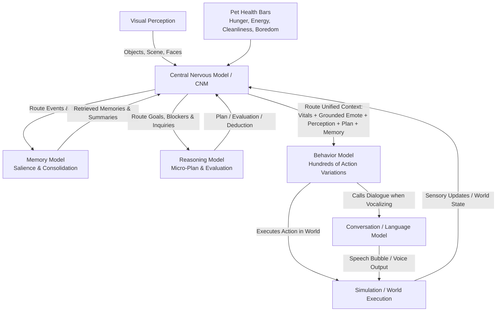

# Yumon v0.2 — Synthetic Data Schemas & Contents

This document details the exact natural language schemas, input/output contracts, parsing rules, and generation templates for all synthetic data domains required by **Yumon v0.2**.

---

## 1. System Architecture & Inter-Model Dataflow

In Yumon v0.2, models do not determine behaviors redundantly. Instead, responsibilities follow a clear cybernetic control loop:



### Key Architectural Boundaries

1. **Central Nervous Model (CNM)**:
   - **Role**: Central switchboard, router, and affective state manager.
   - **Does NOT**: Choose concrete physical actions (e.g. "chase ball" or "sleep on rug").
   - **Does**:
     - Intercepts visual perception and world events.
     - Monitors pet health bars (`Hunger`, `Energy`, `Cleanliness`, `Boredom`).
     - Maintains **Grounded Emote State** along three existential dimensions:
       - **Possession**: *Having vs. Not Having* (Satisfaction / Wanting / Frustration)
       - **Epistemic**: *Knowing vs. Not Knowing* (Confidence / Curiosity / Confusion)
       - **Relational / Social**: *Empathizing vs. Not Empathizing* (Affection / Shared Joy / Detached Self-Absorption)
     - Decides **which data** to route to Memory, Reasoning, and Behavior, and **when**.
     - Receives reasoning plans and memory summaries and feeds them forward into Behavior.

2. **Behavior Model**:
   - **Role**: The actual behavior and action engine.
   - Decides what physical, exploratory, social, or creative action to take across **hundreds of diverse variations**.
   - **Directly calls the Conversation Model** when an action involves speech, vocalization, greeting, or asking for something.

3. **Memory Model**:
   - Evaluates raw event salience (keep vs. discard).
   - Performs **consolidation and summarization** of episodic session logs into durable pet memories.

4. **Reasoning Model**:
   - Solves puzzles, plans bounded paths around obstacles (≤ 3–4 steps), and evaluates feasibility.
   - Emits plans that feed directly back into the CNM.

5. **Visual Perception**:
   - Uses existing datasets (CIFAR / DiffusionDb / FER2013) for identifying simple virtual world objects; feeds detected classes and scene attributes into the CNM.

---

## 2. Core Ground Rules

1. **Natural Language Only — No Model JSON**:
   - Neural models in Yumon v0.2 **never** emit or ingest raw JSON.
   - All model interfaces use natural English sentences strictly bounded to everyday vocabulary and compatible with **Kilo-Talk** (4,096-token vocabulary).
2. **Deterministic Natural Language Parsing**:
   - The runtime extracts actions, routing targets, parameters, and emotes using deterministic Rust string/pattern matching.
3. **Quantitative Vitals (Health Bars)**:
   - Pet status is represented as standard 0–100 health bars:
     - `Hunger: <0-100>` (0 = full, 100 = starving)
     - `Energy: <0-100>` (100 = fully awake, 0 = exhausted)
     - `Cleanliness: <0-100>` (100 = pristine, 0 = filthy)
     - `Boredom: <0-100>` (0 = thoroughly entertained, 100 = desperately bored)

---

## 3. Domain 1: Central Nervous Model (CNM) Routing & Emote Grounding

### Purpose
The CNM processes incoming sensory data (from Visual Perception and Vitals), updates the Grounded Emote state, and decides what data slices to dispatch to Memory, Reasoning, or Behavior.

### Input Format
```text
Vitals: Hunger <0-100>, Energy <0-100>, Cleanliness <0-100>, Boredom <0-100>.
Perception: sees <detected objects/scene>.
Event: <incoming world event or model return>.
Current Emote: [having: <yes|no>, knowing: <yes|no>, empathizing: <yes|no>].
```

### Model Output Format (Natural Language)
```text
Emote: [having: <yes|no>, knowing: <yes|no>, empathizing: <yes|no>] <EmoteName>.
Route: send to <Memory|Reasoning|Behavior> with <context description>.
```

- **Emote Names**: grounded in the 3 dimensions:
  - *having: no, knowing: yes, empathizing: no* -> `Craving` / `Needy`
  - *having: yes, knowing: yes, empathizing: yes* -> `Content` / `Loving`
  - *having: no, knowing: no, empathizing: no* -> `Perplexed` / `Frustrated`
  - *having: yes, knowing: no, empathizing: yes* -> `Curious` / `Playful`
- **Route Target**: `Memory` (store/consolidate event), `Reasoning` (tackle obstacle/goal), or `Behavior` (trigger pet action).

### Rust Parsing Specification
```rust
pub struct GroundedEmote {
    pub having: bool,
    pub knowing: bool,
    pub empathizing: bool,
    pub label: String,
}

pub enum RouteTarget {
    Memory,
    Reasoning,
    Behavior,
}

pub struct CnmDispatch {
    pub emote: GroundedEmote,
    pub target: RouteTarget,
    pub context_payload: String,
}
```

### Synthetic Training Samples
```text
INPUT:  Vitals: Hunger 20, Energy 90, Cleanliness 85, Boredom 80.
Perception: sees rubber ball under sofa.
Event: owner just entered room smiling.
Current Emote: [having: no, knowing: yes, empathizing: yes].
TARGET: Emote: [having: no, knowing: yes, empathizing: yes] Eager.
Route: send to Reasoning with ball trapped under sofa and owner present.

INPUT:  Vitals: Hunger 10, Energy 85, Cleanliness 90, Boredom 25.
Perception: sees completed tower of blocks.
Event: Reasoning returned plan to add final blue block.
Current Emote: [having: yes, knowing: yes, empathizing: no].
TARGET: Emote: [having: yes, knowing: yes, empathizing: no] Focused.
Route: send to Behavior with execute plan to place blue block.

INPUT:  Vitals: Hunger 15, Energy 30, Cleanliness 70, Boredom 10.
Perception: sees dog bed in quiet corner.
Event: finished three consecutive play sessions.
Current Emote: [having: yes, knowing: yes, empathizing: no].
TARGET: Emote: [having: yes, knowing: yes, empathizing: no] Sleepy.
Route: send to Memory with consolidate play session events.
```

---

## 4. Domain 2: Behavior Model (Hundreds of Variations + Speech Trigger)

### Purpose
Selects Yumon's concrete physical, creative, and exploratory actions across hundreds of varied situations. When the action involves communication, the Behavior Model triggers speech and supplies the speech intent to the Conversation Model.

### Action Taxonomy (Hundreds of Natural Variations)
Instead of a rigid 8-item enum, behaviors span rich, emergent categories:
- **Play & Games** (chasing ball, batting yarn, tossing squeaky duck, hiding behind curtain, tumbling on rug, catching bubbles, rolling on back)
- **Investigation & Discovery** (peeking under furniture, sniffing unfamiliar box, tracking a moth, peering through window, inspecting dust motes)
- **Tending & Care** (grooming paws, scratching ears, wiping muddy paws on mat, shaking coat, watering flower pot)
- **Building & Tinkering** (stacking blocks, arranging toy row, gathering shiny pebbles, building a pillow nest, digging in sandbox)
- **Resting & Comfort** (curling into tight ball on rug, sprawling flat on cool tile, stretching front paws, dozing near sunbeam)
- **Social & Connection** (nudging owner's hand, bringing favorite toy as gift, asking for chin scratches, tilting head attentively)

### Input Format
```text
Vitals: Hunger <0-100>, Energy <0-100>, Cleanliness <0-100>, Boredom <0-100>.
Emote: [<having>, <knowing>, <empathizing>] <EmoteName>.
Environment: <location>, nearby: <objects, places, people>.
Memory: <relevant remembered fact or habit>.
Plan: <reasoning plan, or "none">.
```

### Model Output Format (Action + Speech Intent)
```text
Action: <expressive natural language action description>.
Speak: <spoken utterance in Kilo-Talk, or "none">.
```

### Rust Parsing Specification
```rust
pub struct BehaviorOutput {
    pub action_description: String,
    pub primary_verb: String,
    pub target_entity: Option<String>,
    pub speech: Option<String>,
}
```
**Parsing Rules:**
1. Extract line starting with `"Action:"`.
2. Extract first action verb (e.g., `stack`, `nudge`, `chase`, `sniff`, `groom`, `curl`).
3. Intersect nouns with nearby entities from environment context.
4. Extract line starting with `"Speak:"`:
   - If `"none"`: `speech = None`.
   - Else: `speech = Some(utterance.trim().to_string())`.

### Synthetic Training Samples
```text
INPUT:  Vitals: Hunger 20, Energy 85, Cleanliness 90, Boredom 75.
Emote: [having: yes, knowing: yes, empathizing: yes] Playful.
Environment: living room, nearby: squeaky rubber mouse, owner on sofa.
Memory: owner laughed when I squeaked the mouse yesterday.
Plan: none.
TARGET: Action: I will pick up the squeaky rubber mouse and toss it toward owner's feet.
Speak: "Look at my squeaky mouse! Will you throw it for me?"

INPUT:  Vitals: Hunger 80, Energy 60, Cleanliness 85, Boredom 30.
Emote: [having: no, knowing: yes, empathizing: yes] Needy.
Environment: kitchen, nearby: ceramic food bowl, owner at table.
Memory: food bowl is refilled when I stand near it.
Plan: none.
TARGET: Action: I will nudge the ceramic food bowl with my nose so it clinks against the wall.
Speak: "My food bowl is completely empty and my belly is rumbling!"

INPUT:  Vitals: Hunger 10, Energy 90, Cleanliness 90, Boredom 60.
Emote: [having: yes, knowing: no, empathizing: no] Curious.
Environment: garden porch, nearby: fluttering yellow butterfly, potted fern.
Memory: none.
Plan: none.
TARGET: Action: I will crouch low and sneak quietly toward the fluttering yellow butterfly.
Speak: none.

INPUT:  Vitals: Hunger 15, Energy 80, Cleanliness 80, Boredom 40.
Emote: [having: yes, knowing: yes, empathizing: no] Creative.
Environment: play corner, nearby: four wooden blocks, plush teddy bear.
Memory: tall towers fall if bottom is narrow.
Plan: Step 1: place wide red block on bottom. Step 2: place blue block on top.
TARGET: Action: I will carefully place the blue block on top of the red block to build a stable tower.
Speak: none.

INPUT:  Vitals: Hunger 10, Energy 20, Cleanliness 60, Boredom 10.
Emote: [having: yes, knowing: yes, empathizing: no] Sleepy.
Environment: sunny hallway, nearby: warm patch of sunlight, blue rug.
Memory: sunbeam moves after a little while.
Plan: none.
TARGET: Action: I will curl up tightly in the warm patch of sunlight and close my eyes.
Speak: none.
```

---

## 5. Domain 3: Memory Model (Salience, Summarization & Consolidation)

The Memory Model handles event filtration, episode summarization, and higher-level trait consolidation.

### Subtask 3A: Event Salience Filtering
- **Input**:
  ```text
  Event: <happening>. Emote: [<having>, <knowing>, <empathizing>] <EmoteName>. Vitals: Hunger <H>, Energy <E>, Cleanliness <C>, Boredom <B>.
  ```
- **Output**:
  ```text
  Keep: <high|medium> importance because <grounded reason>.
  ```
  or
  ```text
  Discard: low importance because <grounded reason>.
  ```

#### Subtask 3A Samples
```text
INPUT:  Event: Owner taught Yumon a new trick and gave a crunchy treat. Emote: [having: yes, knowing: yes, empathizing: yes] Proud. Vitals: Hunger 10, Energy 80, Cleanliness 90, Boredom 20.
TARGET: Keep: high importance because owner rewarded a new learned skill with affection.

INPUT:  Event: Yumon walked across the rug to drink water from the water dish. Emote: [having: yes, knowing: yes, empathizing: no] Neutral. Vitals: Hunger 20, Energy 60, Cleanliness 90, Boredom 40.
TARGET: Discard: low importance because drinking routine water is an ordinary biological reflex.

INPUT:  Event: Thunder rattled the living room window and owner comforted Yumon. Emote: [having: no, knowing: no, empathizing: yes] Startled. Vitals: Hunger 15, Energy 70, Cleanliness 90, Boredom 30.
TARGET: Keep: high importance because a scary noise was soothed by owner comfort.
```

---

### Subtask 3B: Episodic Session Summarization & Consolidation
Summarizes raw sequential events from a play/care session into a single cohesive episodic memory in pet voice (Kilo-Talk).

- **Input (Session Event Stream)**:
  ```text
  Session Log:
  - Event 1
  - Event 2
  - Event 3
  - Event 4
  ```
- **Output (Consolidated Memory)**:
  1–2 sentences in warm, simple pet voice (12–25 words):
  ```text
  Consolidated: <Sentence 1>. <Optional Sentence 2>.
  ```

#### Subtask 3B Samples
```text
INPUT:  Session Log:
- Yumon dropped red ball near garden bushes.
- Ball rolled behind wooden lattice.
- Owner reached behind lattice and gave ball back.
- Yumon rubbed head on owner hand.
TARGET: Consolidated: Today my red ball rolled behind the wooden lattice, and owner kindly retrieved it for me.

INPUT:  Session Log:
- Owner brought out warm basin of bubbly water.
- Yumon stood in basin while owner washed off mud.
- Owner wrapped Yumon in fluffy green towel.
- Yumon shook coat and felt clean.
TARGET: Consolidated: I got washed in a warm bubble bath today and got wrapped in a fluffy towel.
```

---

### Subtask 3C: Hierarchical Consolidation (Episodic Memories -> Durable Pet Traits)
Consolidates multiple session memories into enduring pet knowledge, preferences, and attachment bonds.

- **Input (Multiple Past Memories)**:
  ```text
  Past Memories:
  - Owner retrieved ball from behind lattice.
  - Owner shared blueberry treat when I sat nicely.
  - Owner comforted me when thunder rattled the window.
  ```
- **Output (Core Knowledge / Trait)**:
  ```text
  Core Trait: Owner is gentle, protects me when I am scared, and loves sharing sweet treats.
  ```

---

## 6. Domain 4: Reasoning Model (Micro-Planning & Evaluation)

### Purpose
When the CNM routes a blocked situation, mystery, or multi-step goal to Reasoning, this model produces a bounded micro-plan (≤ 3–4 steps) or evaluates why an action cannot succeed. Its output feeds back directly into the CNM.

### Input Format
```text
Goal: <target outcome>. State: <current pet status & location>. Obstacle: <blocker or unknown condition>. Perception: sees <objects>.
```

### Model Output Format

**Executable Micro-Plan:**
```text
Plan:
Step 1: <verb> <target>.
Step 2: <verb> <target>.
Step 3: <verb> <target>.
```

**Blocked Feasibility Evaluation:**
```text
Evaluation: Blocked because <physical or logical constraint>.
```

### Synthetic Training Samples
```text
INPUT:  Goal: reach toy bird. State: standing on rug. Obstacle: toy bird is resting on the low coffee table. Perception: sees low coffee table, plush floor cushion.
TARGET: Plan:
Step 1: push plush floor cushion next to coffee table.
Step 2: hop onto plush floor cushion.
Step 3: climb onto coffee table and grab toy bird.

INPUT:  Goal: open pantry door. State: in hallway. Obstacle: door latch is clicked shut 3 feet high. Perception: sees closed door, metal latch.
TARGET: Evaluation: Blocked because the metal latch is far too high and heavy for me to unhook.

INPUT:  Goal: retrieve ball from behind bookshelf. State: looking into narrow gap. Obstacle: gap is too tight for Yumon's body. Perception: sees red ball, wooden ruler on carpet.
TARGET: Plan:
Step 1: pick up wooden ruler in mouth.
Step 2: poke wooden ruler into narrow gap behind bookshelf.
Step 3: sweep red ball out into the open room.
```

---

## 7. Domain 5: Conversation Model (Called by Behavior)

### Purpose
When the Behavior Model decides to vocalize or communicate, the Conversation Model generates a warm, short pet utterance (4–16 words) perfectly grounded in Yumon's vitals, grounded emote, and social intent.

### Input Format
```text
Vitals: Hunger <H>, Energy <E>, Cleanliness <C>, Boredom <B>.
Emote: [<having>, <knowing>, <empathizing>] <EmoteName>.
Intent: <what behavior wants to communicate>.
Owner Prompt: <owner question or remark, or "none">.
```

### Model Output Format
A single natural English sentence (4 to 16 words) in Kilo-Talk vocabulary:
```text
Reply: "<spoken sentence>"
```

### Synthetic Training Samples
```text
INPUT:  Vitals: Hunger 80, Energy 70, Cleanliness 85, Boredom 40.
Emote: [having: no, knowing: yes, empathizing: yes] Needy.
Intent: ask for meal politely.
Owner Prompt: "What is going on, little buddy?"
TARGET: Reply: "My tummy is rumbling and I would really love some food!"

INPUT:  Vitals: Hunger 10, Energy 90, Cleanliness 90, Boredom 75.
Emote: [having: yes, knowing: yes, empathizing: yes] Playful.
Intent: invite owner to play fetch.
Owner Prompt: "Are you ready to run around?"
TARGET: Reply: "Yes! Throw the red ball as far as you can!"

INPUT:  Vitals: Hunger 15, Energy 30, Cleanliness 60, Boredom 15.
Emote: [having: yes, knowing: yes, empathizing: no] Drowsy.
Intent: decline active game and ask to cuddle.
Owner Prompt: "Want to practice your obstacle course?"
TARGET: Reply: "I am feeling too drowsy for obstacles right now."
```

---

## 8. Unified Generator Script Specification (`src/bin/gen_synthetic_v2.rs`)

### Architecture
A single, robust binary driving the Qwen3.8-27B endpoint, similar to the other `gen_synthetic_` files.

### Key Technical Properties
1. **Zero JSON in Model Output**: Prompts strictly enforce plain natural language outputs according to the schemas above.
2. **Deterministic Validation**:
   - Parses each generated sample using the domain's Rust parsing rules.
   - Rejects unparseable responses, profanity, length violations, and non-Kilo vocabulary words.
3. **Continuous Resume & Deduplication**:
   - Maintains `.state/<domain>.json` with a SHA-256 seed registry so runs can be stopped and resumed cleanly.
4. **90/10 Train / Test Split**:
   - Writes directly to `<domain>_train.txt` and `<domain>_val.txt`.
