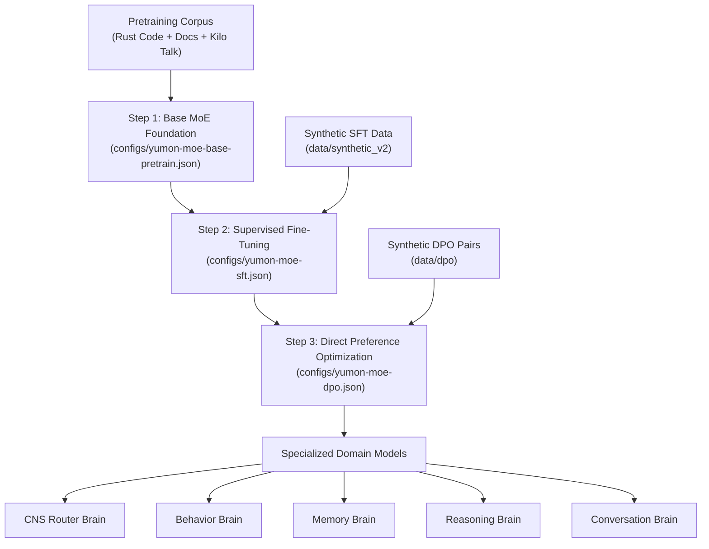

# Yumon v2 InstructGPT Post-Training Alignment Guide

## 1. Executive Summary & Paradigm Shift

In accordance with the **InstructGPT alignment paradigm** (Pretraining $\to$ Supervised Fine-Tuning (SFT) $\to$ Direct Preference Optimization (DPO)), the Yumon v2 architecture replaces task-fragmented LSTMs with **one foundational Mixture of Experts (MoE)** architecture. This base MoE is then specialized into task-specific sub-brains (CNS Router, Behavior, Memory, Reasoning, and Conversation) via SFT and preference alignment.



---

## 2. Directory & Cache Organization

All dataset artifacts and tokenized caches are now cleanly partitioned into distinct stage subdirectories:

| Stage | Raw Synthetic Directory | Intermediate BPE Cache | Kilo Talk Substrate Cache | Config File |
|---|---|---|---|---|
| **Pretrain** | Rust source / Docs | `training-cache/pretrain/samples.bin` | `training-cache/pretrain/kilo_pretrain.bin` | `configs/yumon-moe-base-pretrain.json` |
| **SFT** | `data/synthetic_v2/` | `training-cache/sft/sft_samples.bin` | `training-cache/sft/kilo_sft.bin` | `configs/yumon-moe-sft.json` |
| **DPO** | `data/dpo/` | `training-cache/dpo/dpo_samples.bin` | `training-cache/dpo/kilo_dpo.bin` | `configs/yumon-moe-dpo.json` |

---

## 3. Step-by-Step Operator Runbook

Run the following commands directly in your PowerShell terminal to watch live interactive TUI progress bars, token throughput, and loss curves.

### Step 1: Generate Synthetic Datasets via Qwen API

#### 1A. SFT Instruction Data Generation
Generate balanced prompt/reply datasets across all domains (CNS, behavior, memory, reasoning, conversation):
```powershell
cargo run --release --bin gen_synthetic_v2 -- --domain all --count 3000 --out-dir data/synthetic_v2
```

#### 1B. DPO Contrastive Preference Pair Generation
Generate aligned triplet samples (`INPUT:`, `CHOSEN:`, `REJECTED:`) with strict domain validation on `CHOSEN` and realistic, contrastive failure modes on `REJECTED`:
```powershell
cargo run --release --bin gen_synthetic_v2 -- --mode preference --domain all --count 1500 --out-dir data/dpo
```

---

### Step 2: Multi-Stage Tokenization & Cache Compilation

#### 2A. SFT Sample Cache
Compile the synthetic instruction samples into raw BPE, then project into Kilo Talk tokens:
```powershell
# 1. Compile raw BPE cache
cargo run --release --bin cache_samples -- --dataset data/synthetic_v2 --output training-cache/sft/sft_samples.bin --objective sft --max-seq-len 512 --force

# 2. Project into Kilo Talk 4096-token vocabulary
cargo run --release --bin cache_yumon_talk -- --input-cache training-cache/sft/sft_samples.bin --output training-cache/sft/kilo_sft.bin --vocab training-cache/kilo_talk_vocab.json --max-seq-len 512 --force
```

#### 2B. DPO Preference Cache
Compile the contrastive pairs. The caching pipeline automatically handles pairs atomically ($2k, 2k+1$), guaranteeing chosen and rejected completions never desynchronize:
```powershell
# 1. Compile raw BPE pairs
cargo run --release --bin cache_samples -- --dataset data/dpo --output training-cache/dpo/dpo_samples.bin --objective dpo --max-seq-len 512 --force

# 2. Project into Kilo Talk pairs
cargo run --release --bin cache_yumon_talk -- --input-cache training-cache/dpo/dpo_samples.bin --output training-cache/dpo/kilo_dpo.bin --vocab training-cache/kilo_talk_vocab.json --max-seq-len 512 --force
```

---

### Step 3: Model Post-Training Execution

#### 3A. Base Foundation Model Checkpoint
You can either:
- **Use existing proven checkpoint**:
  `checkpoints/yumon-pet-kilo-deep-light/code_256h_16l_8a_512ff_512len_b2_Moe_e8_k2_f32_yumon_talk_v1_tied/model.bin` (222 MB, epoch 3, final_loss=3.61, val_loss=3.82) is pre-configured as the starting foundation weights in `configs/yumon-moe-sft.json`.
- **Or pretrain a new base model from scratch**:
  ```powershell
  cargo run --release --bin train_code -- --config configs/yumon-moe-base-pretrain.json
  ```

#### 3B. Supervised Fine-Tuning (SFT)
Fine-tune the base MoE on domain instructions. SFT initializes from the base checkpoint and tunes with a lower learning rate ($5 \times 10^{-5} \to 5 \times 10^{-6}$):
```powershell
cargo run --release --bin train_code -- --config configs/yumon-moe-sft.json
```
*Output Checkpoint:* `checkpoints/yumon-v2-sft/model.bin`

#### 3C. Direct Preference Optimization (DPO)
Optimize policy preferences using implicit reward maximization against an un-updated reference model clone $\pi_{\text{ref}}$:
```powershell
cargo run --release --bin train_code -- --config configs/yumon-moe-dpo.json
```

In `configs/yumon-moe-dpo.json`, you can point `"init_checkpoint"` to the checkpoint produced in Step 3B (`checkpoints/yumon-v2-sft/...`) to perform the canonical 2-stage InstructGPT alignment.

---

## 4. Key DPO Mathematical Implementation Details

1. **Loss Function**:
   $$L_{\text{DPO}}(\pi_\theta; \pi_{\text{ref}}) = -\mathbb{E}_{(x, y_w, y_l)} \left[ \log \sigma \left( \beta \log \frac{\pi_\theta(y_w \mid x)}{\pi_{\text{ref}}(y_w \mid x)} - \beta \log \frac{\pi_\theta(y_l \mid x)}{\pi_{\text{ref}}(y_l \mid x)} \right) \right]$$
2. **Numerical Stability**:
   Implemented via stable softplus $\text{softplus}(-z) = \text{relu}(-z) + \log(1 + e^{-|-z|})$ preventing float overflow during extreme reward differences.
3. **Reference Model Execution**:
   A detached deep clone of $\pi_\theta$ is created before training begins. Sequence log-probabilities for $\pi_{\text{ref}}$ are calculated with zero gradient accumulation overhead.
4. **Validation Metrics**:
   Every validation cycle evaluates preference accuracy:
   $$\text{PrefAcc} = \frac{1}{N_{\text{pairs}}} \sum_{i=1}^{N_{\text{pairs}}} \mathbb{I}\left( \log \frac{\pi_\theta(y_w^i \mid x^i)}{\pi_{\text{ref}}(y_w^i \mid x^i)} > \log \frac{\pi_\theta(y_l^i \mid x^i)}{\pi_{\text{ref}}(y_l^i \mid x^i)} \right)$$
   Live metrics display both validation DPO loss and validation win rate on the Ratatui dashboard.
