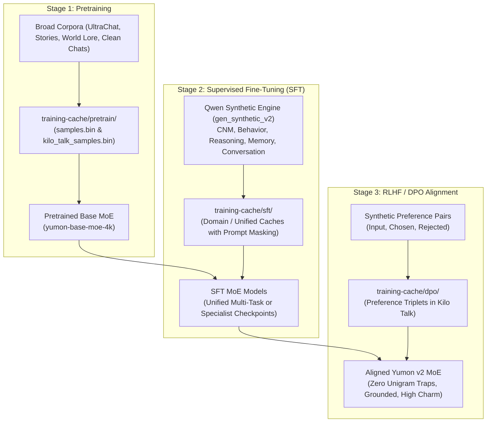
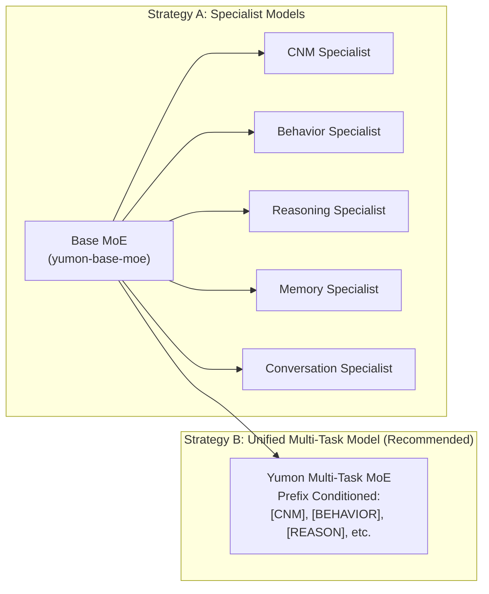
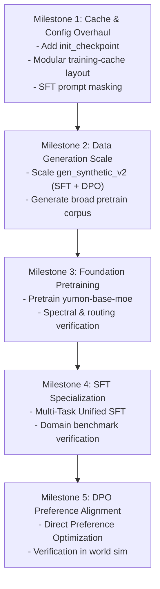

# Yumon v0.2 — InstructGPT Post-Training Alignment Plan

> **Architectural Paradigm**: One Pretrained Foundation MoE $\rightarrow$ Supervised Fine-Tuning (SFT) $\rightarrow$ Direct Preference Optimization (RLHF / DPO).

---

## 1. Executive Summary & Paradigm Shift

### From Fragmented Micro-Models to Unified Foundation Alignment

In the initial draft of `docs/YUMON_v02_PLAN.md`, Yumon's subsystems were envisioned as a patchwork of distinct model families:
- LSTMs for the Central Nervous System (CNS) orchestrator, behavior policies, and memory salience.
- Independent CNNs and classification heads for perception.
- MoE models isolated strictly to code or art generation.

Recent weight analysis (`training-cache/weights_analysis.md`) and training balance experiments (`configs/yumon-talk-moe-balance.json`) demonstrated that our sparse Mixture-of-Experts architecture—with **tied embeddings**, **16 layers**, **8 attention heads**, **256 embed dimensions**, **8 experts with Top-2 routing**, and **auxiliary load-balancing + router z-loss**—learns rich semantic structures, avoids token collapse, and maintains stable gradient propagation.

Following the paradigm proven by **InstructGPT** (Ouyang et al., 2022) and modern foundation model alignment:
1. **Retire Ad-Hoc LSTMs**: Sequence conditioning, memory consolidation, behavioral choices, and routing decisions are all natural language sequence-to-sequence tasks. The MoE foundation handles them natively with far greater expressive power and shared contextual understanding.
2. **One Pretrained MoE Foundation**: We pretrain a single core MoE model (`yumon-base-moe`) on broad conversational, narrative, and world knowledge encoded in **Kilo Talk** (4,096-token vocabulary).
3. **Supervised Fine-Tuning (SFT)**: We adapt the base MoE to the discrete tasks defined in `docs/SYNTHETIC_DATA_SCHEMAS.md` (CNM routing, Behavior selection, Reasoning micro-planning, Memory consolidation, and Conversation dialogue).
4. **Preference Alignment (RLHF / DPO)**: We align the fine-tuned model using Direct Preference Optimization (DPO) to eliminate degenerate generation loops (such as the unigram frequency traps discovered during weight forensics), enforce grounded causality, and ensure charming, consistent pet personality.



---

## 2. Model Architecture: The Unified MoE Backbone

All stages build upon the proven hyperparameter configuration finalized in `configs/yumon-talk-moe-balance.json`:

| Hyperparameter | Value | Rationale & Forensic Justification |
| :--- | :--- | :--- |
| **Architecture** | Sparse MoE Decoder | Causal autoregressive transformer with sparse routing |
| **Vocabulary** | 4,096 tokens | `KiloVocab` compressed English substrate (`training-cache/kilo_talk_vocab.json`) |
| **Embedding Dim ($d_{\text{model}}$)** | 256 | Expands capacity beyond earlier 64-dim bottlenecks; prevents SwiGLU activation starvation |
| **Layers ($N_{\text{layers}}$)** | 16 | Deep representation hierarchy allowing early layers to parse syntax and late layers to model intent |
| **Attention Heads** | 8 (dim 32/head) | Prevents $W_{QK}$ rank-1 attention collapse observed in 4-head configurations |
| **Feedforward Dim ($d_{\text{ff}}$)** | 512 | SwiGLU FFN per expert ($2\times d_{\text{model}}$) |
| **Num Experts ($E$)** | 8 | Sufficient parameter diversity while fitting within local desktop / edge memory |
| **Routing Top-$k$** | 2 | **Critical**: Top-2 routing creates gradient competition between expert pairs, waking up SwiGLU matrices |
| **Tie Embeddings** | `true` | **Critical**: Couples input embedding and output LM head; mathematically eliminates unigram frequency drift |
| **Auxiliary Loss ($\alpha_{\text{aux}}$)** | 0.025 | Penalizes expert load imbalance; maintains uniform capacity utilization |
| **Router Z-Loss ($\alpha_z$)** | 0.01 | Penalizes large router logits; stabilizes softmax routing against floating-point drift |
| **Positional Encoding** | M-RoPE | Multi-axis Rotary Positional Embeddings for temporal and structured sequence awareness |
| **Max Context Length** | 512 | Sufficient for multi-turn dialogue, vitals context, and micro-plans in Kilo Talk |

---

## 3. The 3-Stage Training Pipeline

### Stage 1: Foundation Pretraining (`yumon-base-moe`)

- **Objective**: Learn the statistical syntax, semantics, and world-knowledge of Kilo Talk English.
- **Loss**: Standard unmasked causal Cross-Entropy + MoE balancing loss + Router Z-loss:
  $$\mathcal{L}_{\text{pretrain}} = \mathcal{L}_{\text{CE}}(\mathbf{x}) + \alpha_{\text{aux}} \mathcal{L}_{\text{aux}} + \alpha_z \mathcal{L}_z$$
- **Data Composition**:
  - Distilled general conversations (UltraChat extract, clean multi-turn dialogues).
  - Everyday stories, descriptions, simple encyclopedic text.
  - Pet world lore (virtual world objects, habitats, simple physics, actions).
- **Target Scale**: 5M–10M tokens in Kilo Talk representation.
- **Output Artifact**: `checkpoints/yumon-base-moe/` (reusable foundation weights).

---

### Stage 2: Supervised Fine-Tuning (SFT)

- **Objective**: Adapt the base model to follow specific system contracts defined in `docs/SYNTHETIC_DATA_SCHEMAS.md`.
- **Key Technical Requirement: Prompt Loss Masking**:
  - In pretraining, all tokens are supervised.
  - In SFT, **prompt tokens must be masked out** (`target = PAD_TOKEN` or explicit binary mask). Gradients only backpropagate through the model's generated response:
    $$\mathcal{L}_{\text{SFT}} = -\frac{1}{T_{\text{target}}} \sum_{t \in \text{Target}} \log P_\theta(x_t \mid x_{<t})$$
- **Task Domains**:
  1. **CNM (Central Nervous Model)**: Sensory routing, vitals monitoring, and 3D grounded emotes (`having`, `knowing`, `empathizing`).
  2. **Behavior Model**: Hundreds of emergent action variations + speech triggers (`Action: ... Speak: ...`).
  3. **Reasoning Model**: Bounded micro-plans (≤ 3–4 steps) and blocked feasibility evaluations.
  4. **Memory Model**:
     - *3A Salience*: Event keep vs. discard with grounded justification.
     - *3B Session Consolidation*: Multi-event log $\rightarrow$ warm pet memory.
     - *3C Trait Synthesis*: Multiple memories $\rightarrow$ durable pet bond.
  5. **Conversation Model**: Warm, pet-voiced short utterances (4–16 words) called by Behavior.

#### SFT Architecture Strategy: Unified vs. Specialist Checkpoints

We have two deployment strategies for SFT:



- **Strategy A (Domain Specialists)**: Train independent checkpoints from the base MoE for each domain.
  - *Pros*: Maximum parameter dedication per domain.
  - *Cons*: High memory footprint (loading 5 separate ~220MB models into VRAM simultaneously).
- **Strategy B (Unified Multi-Task MoE — Recommended)**:
  - Add domain prompt tokens: `[CNM]`, `[BEHAVIOR]`, `[REASON]`, `[MEMORY]`, `[TALK]`.
  - Train a single MoE on a balanced mixture of all SFT domains.
  - *Pros*: Only **one** model loaded in runtime VRAM (~220MB total); routing experts specialize naturally by domain across layers; cross-task transfer (reasoning plans inform behavior actions directly).
  - *Fallback*: If a particular task (e.g. CNM deterministic routing) requires 100% precision, branch that specific model into a specialist checkpoint.

---

### Stage 3: Preference Alignment (RLHF / Direct Preference Optimization)

- **Why DPO over Traditional PPO for Yumon?**
  - Standard PPO requires initializing four models concurrently (Actor, Critic, Reference Policy, Reward Model) plus dynamic rollout buffers, which is prohibitive in resource-constrained environments and complex in Burn.
  - **DPO (Rafailov et al., 2023)** mathematically solves the exact same RLHF objective directly on the policy network using paired preferences $(x, y_w, y_l)$:
    $$\mathcal{L}_{\text{DPO}}(\pi_\theta; \pi_{\text{ref}}) = -\mathbb{E}_{(x, y_w, y_l)} \left[ \log \sigma \left( \beta \log \frac{\pi_\theta(y_w \mid x)}{\pi_{\text{ref}}(y_w \mid x)} - \beta \log \frac{\pi_\theta(y_l \mid x)}{\pi_{\text{ref}}(y_l \mid x)} \right) \right]$$
  - Where $\pi_{\text{ref}}$ is frozen SFT weights, $\pi_\theta$ is the active policy, and $\beta$ controls KL regularization (typically $0.1 - 0.2$).

#### What Preference Alignment Solves in Yumon

| Domain | Chosen Completion ($y_w$) | Rejected Completion ($y_l$) |
| :--- | :--- | :--- |
| **Conversation** | Warm, contextual, snappy (e.g. *"Yes! Let's toss the red ball!"*) | Unigram frequency loops (*"time, love, night, heart, is"*); robotic or long-winded replies. |
| **CNM** | Proactive routing based on urgent vitals (e.g. routing to Behavior to eat when Hunger > 80) | Oscillating routing loops; ignoring critical pet health bars; invalid routing destinations. |
| **Behavior** | Emergent, playful actions interacting with visible objects | Contradictory actions (e.g. sleeping while playing); hallucinating objects not in environment. |
| **Reasoning** | Physically plausible 2-3 step micro-plans using available tools | Illogical steps (e.g. jumping over 10-foot obstacles); circular micro-plans. |
| **Memory** | Concise, charming pet memories capturing emotional bonding | Trivial fact logs; verbatim copy-paste of raw sensor streams. |

---

## 4. Dataset Generation Enhancements (`gen_synthetic_v2.rs`)

`src/bin/gen_synthetic_v2.rs` already features robust schema parsers and Qwen API drivers. To support the InstructGPT pipeline, it will be extended with:

### 1. Preference Triplet Generation (`--mode preference`)
For each prompt $x$, generate or construct two candidate outputs:
- **Winning output ($y_w$)**: Sampled at low temperature ($\tau = 0.3$), passing all schema validations and quality heuristics.
- **Losing output ($y_l$)**:
  - *Hard negatives*: Generated by injecting known failure modes (unigram loops, out-of-context hallucinations, broken micro-plan steps, emote mismatch).
  - *Perturbation negatives*: Swapping grounded emotes or routing targets to teach the model boundary discrimination.

### 2. Broad Pretraining Data Generation
- Generate rich world descriptions, object interaction narratives, and diverse pet dialogues to augment the pretraining cache.

### 3. Scaled Generation Targets

| Stage / Dataset | Current Count | Target Count | Output Path |
| :--- | :--- | :--- | :--- |
| **Pretraining Corpus** | ~50k samples | 250k–500k samples | `data/pretrain/general_talk.txt` |
| **SFT: CNM Routing** | 1,000 samples | 25,000 samples | `data/synthetic_v2/cnm_{train,val}.txt` |
| **SFT: Behavior Actions** | 1,000 samples | 35,000 samples | `data/synthetic_v2/behavior_{train,val}.txt` |
| **SFT: Reasoning Plans** | ~0 samples | 20,000 samples | `data/synthetic_v2/reasoning_{train,val}.txt` |
| **SFT: Memory (3A/3B/3C)** | ~1,000 samples | 20,000 samples | `data/synthetic_v2/memory_{train,val}.txt` |
| **SFT: Conversation** | ~0 samples | 30,000 samples | `data/synthetic_v2/conversation_{train,val}.txt` |
| **DPO: Preference Pairs** | 0 pairs | 15,000 pairs (all domains) | `data/dpo/<domain>_pairs.jsonl` |

---

## 5. Caching System Architecture: Modular Samples & Kilo Samples

### Current Bottleneck
Currently, caching relies on a single monolithic `training-cache/samples.bin` and `training-cache/kilo_talk_samples.bin`, with hardcoded file paths in `src/brain/train.rs` (`stage_data_loader`). Training runs cannot cleanly target distinct datasets or preserve prompt masking.

### New Modular Cache Layout
We organize the cache directory hierarchically by training phase and objective:

```text
training-cache/
├── vocab/
│   ├── kilo_talk_vocab.json           # 4,096-token vocabulary
│   └── kilo_talk_tokenizer/           # BPE tokenizer assets
├── pretrain/
│   ├── pretrain_samples.bin           # Raw tokenized sequences (unmasked)
│   └── kilo_pretrain.bin              # Kilo Talk encoded pretraining cache
├── sft/
│   ├── cnm/
│   │   ├── samples.bin
│   │   └── kilo_cnm.bin               # Prompt-masked SFT cache
│   ├── behavior/
│   │   ├── samples.bin
│   │   └── kilo_behavior.bin
│   ├── reasoning/
│   │   ├── samples.bin
│   │   └── kilo_reasoning.bin
│   ├── memory/
│   │   ├── samples.bin
│   │   └── kilo_memory.bin
│   ├── conversation/
│   │   ├── samples.bin
│   │   └── kilo_conversation.bin
│   └── unified/
│       ├── samples.bin                # Balanced mixture of all 5 domains
│       └── kilo_unified_sft.bin
└── dpo/
    ├── cnm_preference.bin             # (Prompt, Chosen, Rejected) triplets
    ├── behavior_preference.bin
    ├── conversation_preference.bin
    └── unified_dpo.bin
```

### Cache Format Upgrades (`src/brain/sample_cache.rs`)

1. **`CacheObjective` Expansion**:
   ```rust
   pub enum CacheObjective {
       PretrainCausal,  // Loss computed across all tokens
       SftInstruction,  // Prompt tokens masked (PAD target); loss only on completion
       DpoPreference,   // Paired chosen and rejected token sequences
       RawCode,         // Legacy Rust code chunks
   }
   ```
2. **`Sample` Mask Representation**:
   - For `SftInstruction`, `target_labels` replaces prompt token IDs with `PAD_TOKEN`.
   - `masked_token_ce` in `src/brain/train.rs` natively ignores `PAD_TOKEN`, immediately achieving zero loss on prompts without changing the forward pass.

3. **Unified Caching Tooling**:
   Enhance `src/bin/cache_samples.rs` and `src/bin/cache_yumon_talk.rs` with explicit CLI arguments:
   ```bash
   # 1. Cache SFT samples for a specific domain or unified mix
   cargo run --release --bin cache_samples -- \
       --source data/synthetic_v2/behavior_train.txt \
       --output training-cache/sft/behavior/samples.bin \
       --objective sft --max-seq-len 512

   # 2. Convert to Kilo Talk substrate
   cargo run --release --bin cache_yumon_talk -- \
       --input-cache training-cache/sft/behavior/samples.bin \
       --vocab training-cache/vocab/kilo_talk_vocab.json \
       --output training-cache/sft/behavior/kilo_behavior.bin \
       --max-seq-len 512
   ```

---

## 6. Training Infrastructure Upgrades (`src/brain/train.rs`)

To support fine-tuning from a base model without collisions:

### 1. `init_checkpoint` in `CodeConfig`
Currently, `run_code` checks:
```rust
anyhow::ensure!(previous["cache"] == identity["cache"], "checkpoint cache identity differs");
```
This intentionally prevents accidentally resuming a run with mismatched data.
We introduce an explicit `init_checkpoint: Option<PathBuf>` parameter:
- When set, the trainer creates a fresh `out_dir` run with its own new cache identity.
- It loads the model weights from `init_checkpoint` as the starting point (epoch 0 of the new stage) instead of random initialization.
- Optimizer states (AdamW moments) are reset fresh for the fine-tuning phase with appropriate SFT learning rates ($3\times 10^{-5} \to 3\times 10^{-6}$).

### 2. DPO Loss Implementation
Add a dedicated DPO training step in `src/brain/train.rs`:
```rust
fn dpo_loss<B: AutodiffBackend>(
    policy_chosen_logps: Tensor<B, 1>,
    policy_rejected_logps: Tensor<B, 1>,
    reference_chosen_logps: Tensor<B, 1>,
    reference_rejected_logps: Tensor<B, 1>,
    beta: f64,
) -> Tensor<B, 1> {
    let pi_logratios = policy_chosen_logps - policy_rejected_logps;
    let ref_logratios = reference_chosen_logps - reference_rejected_logps;
    let logits = (pi_logratios - ref_logratios) * beta;
    burn::tensor::activation::log_sigmoid(logits).neg().mean()
}
```

---

## 7. Execution Roadmap & Milestones



### Milestone 1: Caching & Trainer Upgrades
- [ ] Add `init_checkpoint` to `CodeConfig` in `src/brain/code_corpus.rs`.
- [ ] Add `CacheObjective::SftInstruction` and `CacheObjective::DpoPreference` in `src/brain/sample_cache.rs`.
- [ ] Verify prompt loss masking in `src/brain/train.rs`.
- [ ] Update `cache_samples.rs` and `cache_yumon_talk.rs` to support `--stage {pretrain, sft, dpo}`.

### Milestone 2: Synthetic Data & Preference Expansion
- [ ] Update `src/bin/gen_synthetic_v2.rs` with `--mode preference` generating `(Input, Chosen, Rejected)`.
- [ ] Run generation jobs for all 5 domains to achieve target training volumes.
- [ ] Build and verify the modular caches (`training-cache/pretrain/`, `training-cache/sft/`, `training-cache/dpo/`).

### Milestone 3: Base MoE Foundation Pretraining
- [ ] Launch `yumon-base-moe` pretraining on `kilo_pretrain.bin`.
- [ ] Validate balanced routing across all 8 experts using `analyze_weights.rs`.
- [ ] Verify absence of attention sink collapse and proper singular value decay.

### Milestone 4: SFT Specialization
- [ ] Fine-tune `yumon-sft-unified` from `yumon-base-moe` on `kilo_unified_sft.bin`.
- [ ] Evaluate domain outputs against the deterministic parsers in `gen_synthetic_v2.rs` (100% parse success rate).

### Milestone 5: DPO Alignment & Runtime Integration
- [ ] Run DPO alignment on preference triplets.
- [ ] Verify elimination of repetitive unigram attractors in conversation.
- [ ] Wire the unified aligned MoE into `yumon_portal.rs` and the virtual tabletop world.
